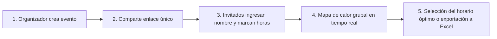

# 🗓️ Disponibilidad de Horarios — Coordinador Grupal Inteligente

[](https://nextjs.org/)
[](https://react.dev/)
[](https://www.typescriptlang.org/)
[](https://tailwindcss.com/)
[](https://opensource.org/licenses/MIT)

> **Plataforma web moderna, intuitiva y segura para coordinar horarios y encontrar el mejor momento para reunirse en grupo, sin necesidad de registros obligatorios ni formularios engorrosos.**

🔗 **Demo en Producción:** [https://disponibilidad-horarios.vercel.app/](https://disponibilidad-horarios.vercel.app/)

---

## 📖 ¿De qué trata el proyecto?

Coordinar una reunión entre múltiples personas (equipos de trabajo, grupos universitarios, amigos o comunidades) suele ser un proceso caótico lleno de mensajes interminables de mensajería (*"¿Quién puede el martes?", "Yo solo por la tarde", "A mí se me complica"*).

**Disponibilidad de Horarios** soluciona este problema mediante una experiencia fluida inspirada en herramientas como *When2meet* o *LettuceMeet*, pero con una interfaz visual contemporánea, soporte para dispositivos móviles, modo oscuro nativo, exportación a Excel y un sistema de seguridad criptográfica sin contraseñas.

El organizador crea un evento en segundos, comparte un único enlace, y cada participante simplemente escribe su nombre y "pinta" las horas en las que está libre. El sistema consolida automáticamente las respuestas en un **mapa de calor grupal visual**, revelando de inmediato los bloques con mayor coincidencia de asistencia.

---

## ✨ Características Principales

### 🎯 1. Creación Flexible de Eventos
- **Por fechas específicas:** Selecciona días exactos en un calendario interactivo.
- **Por días de la semana:** Ideal para planificar rutinas recurrentes (ej. Lunes a Viernes).
- **Rangos horarios personalizados:** Configura la hora de inicio y fin (ej. 08:00 a 20:00).
- **Intervalos configurables:** Franjas de 15, 30 o 60 minutos según la precisión requerida.
- **Enlace único autocompartible:** Genera un link directo con botón para copiar al portapapeles o enviar por WhatsApp.

### 🎨 2. Grilla Interactiva y Experiencia Móvil de Primera
- **Arrastre fluido (*Drag & Select*):** Marca y desmarca múltiples franjas horarias arrastrando el ratón en escritorio.
- **Controles táctiles optimizados para móviles:**
  - **Modo Pintar:** Arrastra el dedo sobre la pantalla para marcar horas rápidamente.
  - **Modo Tocar:** Toca celdas individuales permitiendo desplazarte vertical u horizontalmente por la pantalla sin pintar involuntariamente.
- **Acciones rápidas:** Botones para *"Marcar todo disponible"* o *"Limpiar selección"* en un solo clic.

### 📊 3. Mapa de Calor Grupal (Heatmap)
- **Gradiente visual dinámico:** Celdas con tonalidades de color verde que varían según la densidad de asistentes (desde un verde tenue hasta esmeralda vibrante para el 100% de asistencia).
- **Inspección en tiempo real (Tooltips):** Al pasar el cursor o pulsar sobre cualquier celda, visualiza el desglose exacto:
  - Total y porcentaje de personas disponibles (ej. *"4 de 5 personas libres — 80%"*).
  - Nombres de los participantes disponibles.
  - Nombres de los participantes ausentes.
- **Filtro individual:** Haz clic sobre cualquier participante en la lista lateral para aislar y ver únicamente su horario personal.

### 🔒 4. Seguridad Criptográfica y Rol de Administrador
- **Cero registros forzados:** Los participantes solo ingresan su nombre o apodo, sin necesidad de crear cuentas ni contraseñas.
- **Tokens secretos de participante:** Cada vez que alguien guarda su disponibilidad, el servidor genera un token criptográfico único (`crypto.randomBytes(16)`) que se almacena en su navegador (`localStorage`).
- **Protección contra suplantación:** Ningún usuario ajeno puede escribir el nombre de otra persona para sobreescribir o borrar su horario.
- **Rol de Creador (Admin):** El organizador del evento cuenta con una clave maestra (`adminKey`) que le permite moderar el evento y eliminar participantes si es necesario.
- **Retiro voluntario:** Cada invitado puede modificar o retirar su propio horario en cualquier momento.

### 📥 5. Exportación a Microsoft Excel (`.xlsx`)
- Descarga un reporte completo y profesional en formato Excel generado con [ExcelJS](https://github.com/exceljs/exceljs).
- Incluye el título del evento, metadatos, tabla de participantes y la matriz completa de disponibilidad horaria formateada visualmente.

### 🌙 6. Modo Oscuro & Diseño Moderno
- Interfaz moderna construida con Tailwind CSS v4 y tipografía de alta legibilidad.
- Soporte para **Modo Oscuro (Dark Mode)** y **Modo Claro (Light Mode)** con alternador manual persistente en el navegador y detección automática de preferencia del sistema operativo.

### ⚡ 7. Arquitectura Resiliente y Auto-Sanación (*Self-Healing*)
- Compatible tanto con entornos serverless efímeros (como **Vercel** o **AWS Lambda**) como con servidores tradicionales.
- Respaldo dual: soporte nativo para **Upstash Redis** (en la nube) y motor local ultraligero **SQLite** (`node:sqlite`).
- Si la memoria de un contenedor serverless expira, los enlaces compartidos y el almacenamiento del cliente auto-reparan y restauran la sala del evento automáticamente sin pérdida de información.

---

## 🧭 ¿Cómo funciona? (Flujo de Uso)



1. **Crear el evento:** Entra a la página de inicio, ingresa el título, selecciona las fechas y el rango de horas, y pulsa *"Crear Reunión"*.
2. **Invitar al grupo:** Copia el enlace generado y compártelo en tu grupo de WhatsApp, Slack, Teams o correo.
3. **Completar disponibilidad:** Cada integrante abre el enlace en su celular o computadora, escribe su apodo y marca sus bloques libres.
4. **Descubrir el mejor momento:** Consulta la pestaña *"Ver grupo"* para ver qué horas reúnen a la mayor cantidad de personas.

---

## 🛠️ Stack Tecnológico

| Capa | Tecnología |
| :--- | :--- |
| **Framework Fullstack** | [Next.js 16.4.4](https://nextjs.org/) (App Router, Turbopack) |
| **Biblioteca UI** | [React 19](https://react.dev/) |
| **Lenguaje** | [TypeScript 5](https://www.typescriptlang.org/) |
| **Estilos y Diseño** | [Tailwind CSS v4](https://tailwindcss.com/) |
| **Iconografía** | [Lucide React](https://lucide.dev/) |
| **Generación de Archivos** | [ExcelJS](https://github.com/exceljs/exceljs) |
| **Almacenamiento Serverless** | [Upstash Redis](https://upstash.com/) |
| **Almacenamiento Local** | SQLite nativo de Node.js (`node:sqlite`) |
| **Despliegue** | [Vercel](https://vercel.com/) |

---

## 💻 Instalación y Ejecución Local

### Prerrequisitos
- [Node.js](https://nodejs.org/) versión **20.0.0** o superior.
- Gestor de paquetes `npm` (incluido con Node.js).

### Pasos

1. **Clonar el repositorio:**
   ```bash
   git clone https://github.com/Antholl73/disponibilidad_horarios.git
   cd disponibilidad_horarios
   ```

2. **Instalar dependencias:**
   ```bash
   npm install
   ```

3. **Configurar variables de entorno (Opcional):**
   Para entornos de producción o persistencia en la nube con Upstash Redis, crea un archivo `.env.local`:
   ```env
   UPSTASH_REDIS_REST_URL="https://tu-db.upstash.io"
   UPSTASH_REDIS_REST_TOKEN="tu-token-aqui"
   ```
   > *Nota: Si no se configuran estas variables, la aplicación utilizará automáticamente la base de datos local SQLite (`node:sqlite`) almacenada en `./data/disponibilidad.db`.*

4. **Iniciar en modo desarrollo:**
   ```bash
   npm run dev
   ```
   Abre [http://localhost:3000](http://localhost:3000) en tu navegador para ver la aplicación funcionando.

5. **Compilar para producción:**
   ```bash
   npm run build
   npm run start
   ```

---

## 📂 Estructura del Proyecto

```text
disponibilidad_horarios/
├── src/
│   ├── app/
│   │   ├── api/
│   │   │   ├── events/
│   │   │   │   ├── route.ts                      # Crear y consultar eventos
│   │   │   │   └── [id]/
│   │   │   │       ├── route.ts                  # Datos de evento con heatmap y admin check
│   │   │   │       ├── export/route.ts           # Generador de archivo Excel (.xlsx)
│   │   │   │       └── participants/route.ts     # Guardado y eliminación con tokens
│   │   ├── event/[id]/
│   │   │   └── page.tsx                          # Página de la sala de evento
│   │   ├── globals.css                           # Estilos globales y Tailwind CSS v4
│   │   ├── layout.tsx                            # Layout principal con Navbar y ThemeProvider
│   │   └── page.tsx                              # Landing page y creador de eventos
│   ├── components/
│   │   ├── AvailabilityGrid.tsx                  # Cuadrícula interactiva de selección (drag/touch)
│   │   ├── EventRoomClient.tsx                   # Controlador cliente de la sala del evento
│   │   ├── GroupHeatmap.tsx                      # Componente del mapa de calor y tooltips
│   │   ├── ThemeToggle.tsx                       # Alternador de modo oscuro / claro
│   │   └── ClientEventRecovery.tsx               # Auto-recuperación de eventos en el cliente
│   ├── lib/
│   │   ├── db.ts                                 # Inicializador de SQLite nativo (node:sqlite)
│   │   ├── storage.ts                            # Capa de almacenamiento dual (Redis / SQLite)
│   │   └── services/
│   │       └── eventService.ts                   # Lógica de cálculo de heatmap y seguridad
│   └── types/
│       └── index.ts                              # Definiciones de TypeScript e interfaces
├── public/                                       # Recursos estáticos
├── package.json                                  # Scripts y dependencias
└── README.md                                     # Documentación del proyecto
```

---

## 📄 Licencia

Este proyecto se encuentra bajo la licencia [MIT](LICENSE). Siéntete libre de utilizarlo, modificarlo y adaptarlo a tus necesidades.
